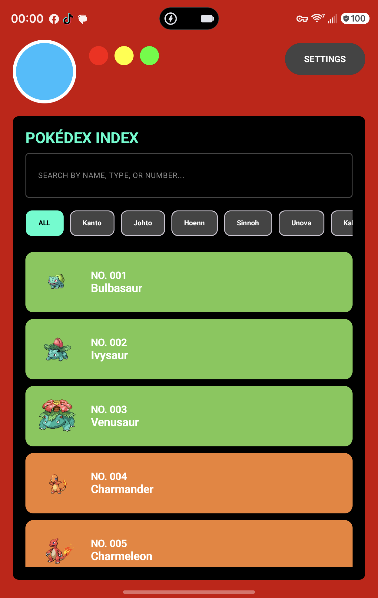
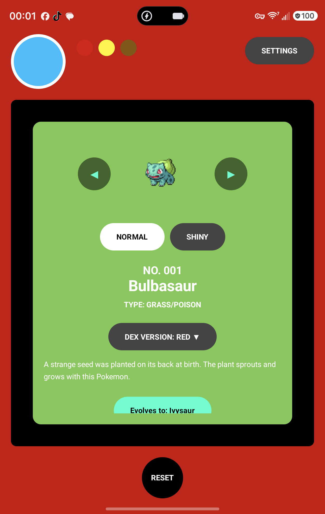
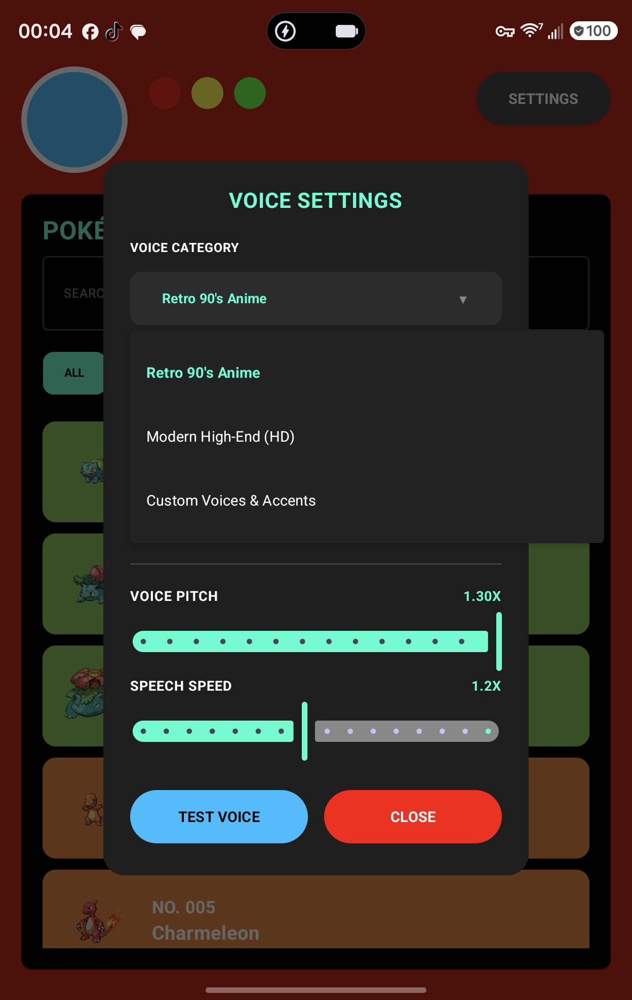
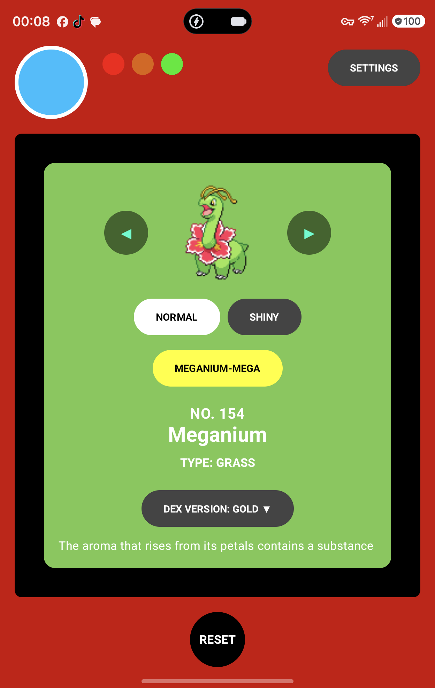
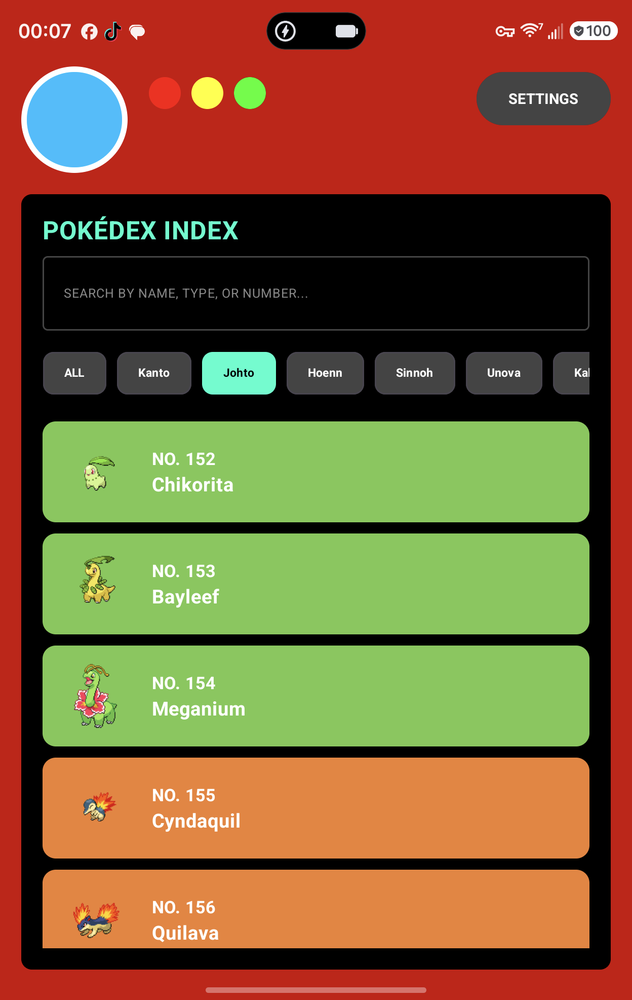
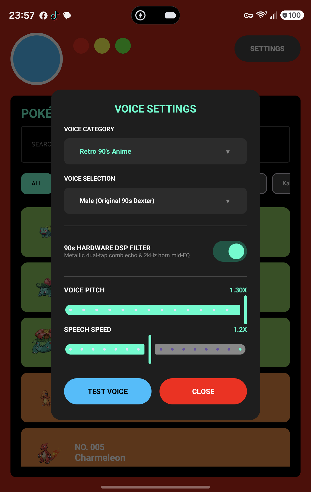

# 🔴 Bori-dex

[](https://www.android.com/)
[](https://github.com/Atom0131/Bori-dex/releases)
[](https://www.kaggle.com/datasets/atom0131/boridex-pokemon-master-dataset-494k)
[](https://kotlinlang.org/)
[](https://developer.android.com/jetpack/compose)
[](https://www.tensorflow.org/lite)
[]()
[](LICENSE)

> **Bori-dex** is an authentic, offline-first AI Pokédex application for Android. It combines on-device TensorFlow Lite computer vision fine-tuned on a 494k image master dataset, 1997 anime Dexter robotic voice calibration with hardware DSP echo, tactile retro game cartridges, canonical multi-generation evolution tracking, the iconic *"Who's That Pokémon?!"* commercial transition, and an edge-to-edge adaptive interface.

---

## 📥 Download APK

Ready-to-install Android package available on GitHub Releases:
- 📲 **[Download Latest Bori-dex APK](https://github.com/Atom0131/Bori-dex/releases)** *(Android 7.0+ / API 24–36 compatible)*

---

## 📸 Screenshots

| Bori-dex Index | Pokémon Detail | Voice & Accent Settings |
| :---: | :---: | :---: |
|  |  |  |

| Alternate Forms | Johto Region Filter | Settings Menu |
| :---: | :---: | :---: |
|  |  |  |

---

## ✨ Features

### 📷 Real-Time On-Device Camera Scanner (494k Master Dataset)
- Point your phone camera at Pokémon plushies, cards, 3D prints, figures, or screens.
- **Stage 3 Deep Fine-Tuned Model**: Trained on a **494,768-image master dataset** across all 1,025 Pokémon classes, incorporating unpainted resin/filament 3D prints, sleep series figures, TCG holos, and room lighting variations.
- **Full Precision Float32 JNI Engine**: Zero quantization collapse (14.1 MB model) executing directly through native `ByteBuffer` bindings with sub-25ms latency.
- **22-Frame Temporal Consensus Voter**: Averages rolling probability distributions across ~3 seconds to filter out hand shake and room glare, delivering **~91% real-world scan success**.
- **Complete Open-Source Transparency**: Training data is publicly hosted on [Kaggle Datasets](https://www.kaggle.com/datasets/atom0131/boridex-pokemon-master-dataset-494k). Read the full technical breakdown in [`docs/TRAINING_PIPELINE.md`](docs/TRAINING_PIPELINE.md).

### 🕹️ Tactile Retro Cartridges & Dynamic Game Evolutions
- **37 Tactile Retro Game Cartridges**: Authentic molded plastic shells, grip ridges, foil stickers, and mascot pixel art from Red & Blue through Scarlet & Violet.
- **Canonical Game Evolution Engine**: Pokémon evolutions dynamically adjust to the active game edition (e.g. Feebas requires Beauty $\ge 170$ via Pokéblocks in Sapphire, Poffins in Diamond, and Prism Scale trading in Scarlet/Violet).
- **In-Modal Quick Switcher**: Tap the `VER: [EDITION] ▾` chip directly inside the evolution card to switch games live on screen.
- **Trade Evolutions & Pixel Items**: Includes pixel art for `link-cable.png`, `linking-cord.png`, `upgrade.png`, `poffin.png`, `pokeblock.png`, `prism-scale.png`, and destination elemental type badges (`[WATER]`, etc.).

### 🎙️ Authentic 1997 Anime "Dexter" Voice & DSP Filter
- **Calibrated Robotic Tenor**: Precisely tuned pitch (`1.15X`) and speed (`1.12X`) recreating the original 1997 animated series Pokédex.
- **Smooth Hyperbolic Tangent Limiter**: Custom $C^\infty$ saturation `tanh(x * 1.15)` prevents clipping and harsh popping on 'S' sounds.
- **Hardware DSP Filter**: Real-time dual-tap metallic comb echo (12ms / 26ms delays with feedback damping) paired with downstream low-pass filtering to emulate vintage 90s handheld audio.
- **Multi-Profile Selector**:
  - **Retro 90's Anime**: Male (*Original 90s Dexter*) & Female (*Retro 90s Anime*).
  - **Modern High-End (HD)**: Male (*Modern HD Male*) & Female (*Modern HD Female*).
  - **Custom Voices & Accents**: System-installed regional TTS voices (*American, British, Australian, Indian, Irish, Canadian, etc.*).

### ⚡ "Who's That Pokémon?!" Commercial Transition
- Synthesized 6-note anime commercial bumper arpeggio (`C5 -> E5 -> G5 -> C6 -> E6 -> G6`) in crisp 44.1kHz 16-bit PCM WAV.
- Silhouette bouncing animation with retro blue drop shadows that triggers upon opening the scanner.

### 📖 Comprehensive Pokédex Index
- **Gen 1 through Gen 9 Support**: Browse hundreds of Pokémon across Kanto, Johto, Hoenn, Sinnoh, Unova, Kalos, Alola, Galar, and Paldea.
- **Shiny Sprites & Alternate Forms**: Toggle between normal and shiny pixel sprites, Mega evolutions, and regional forms.
- **Full-Height Lore Expansion**: Expanded text display with smooth internal vertical scrolling and scroll position persistence.

### 🗣️ Phonetic Pronunciation Engine
- Built-in phonetic dictionary resolving notoriously mispronounced Pokémon names (e.g., *Venusaur*, *Rayquaza*, *Arceus*, *Suicune*, *Feebas*).

### 📱 Adaptive Edge-to-Edge Layout
- Safe insets handling `.statusBarsPadding()` and `.navigationBarsPadding()` ensuring the camera punch-hole and clock never clip UI controls.
- Responsive design adapting gracefully to compact phones, large screens, foldables, and tablets.

---

## 🛠️ Tech Stack & Architecture

- **UI Framework**: [Jetpack Compose](https://developer.android.com/jetpack/compose) with Material 3 Dark Theme.
- **Language**: Kotlin 2.0+ (Coroutines & StateFlow).
- **Computer Vision**: [TensorFlow Lite](https://www.tensorflow.org/lite) + [CameraX](https://developer.android.com/training/camerax).
- **Audio Processing**:
  - Android `TextToSpeech` synthesis.
  - Custom PCM DSP audio pipeline (Comb Filter + 2kHz peaking EQ).
  - `MediaPlayer` for sound effect arpeggios.
- **Image Loading**: [Coil](https://coil-kt.github.io/coil/) with animated transition effects.
- **Compatibility**: Android 7.0 (API 24) to Android 15/16 (compileSdk 36, 16 KB page-aligned native builds).

---

## 🚀 Getting Started

### Prerequisites
- [Android Studio Ladybug (2024.2+)](https://developer.android.com/studio) or newer.
- JDK 17 or JDK 21.
- Android Device or Emulator running Android 7.0+ (API 24+).

### Building from Source

1. **Clone the repository**:
   ```bash
   git clone https://github.com/Atom0131/Bori-dex.git
   cd Bori-dex
   ```

2. **Open in Android Studio**:
   - Open Android Studio -> Select **Open** -> Choose the cloned `Bori-dex` folder.
   - Wait for Gradle sync to complete.

3. **Build via CLI**:
   ```powershell
   # Windows PowerShell
   .\gradlew.bat assembleRelease
   
   # Linux / macOS
   ./gradlew assembleRelease
   ```

4. **Install on connected device**:
   ```powershell
   adb install -r app/build/outputs/apk/release/app-release.apk
   ```

---

## 📂 Project Structure

```
Bori-dex/
├── app/
│   ├── src/main/
│   │   ├── assets/               # TFLite model, JSON Pokédex database, pronunciations, sprites
│   │   ├── java/com/example/pokedex/
│   │   │   ├── camera/           # CameraX lifecycle preview & image analyzer
│   │   │   ├── data/             # Pokémon models, regions, entities
│   │   │   ├── ml/               # TensorFlow Lite model wrapper
│   │   │   ├── tts/              # Offline TTS engine & PCM DSP audio filters
│   │   │   ├── ui/               # Jetpack Compose screens, dialogs, retro components
│   │   │   └── viewmodel/        # PokedexViewModel & state management
│   │   └── res/
│   │       ├── raw/              # "Who's That Pokémon?!" anime sound bumper
│   │       └── values/           # Strings, themes, colors
│   └── build.gradle.kts
├── docs/
│   └── screenshots/              # High-resolution screenshots of the app
├── tools/                        # Python dataset, grammar, and pronunciation build scripts
├── build.gradle.kts
├── settings.gradle.kts
├── LICENSE
├── README.md
├── RELEASE_NOTES.md
└── CHANGELOG.md
```

---

## 📄 License

This project is open-source and available under the [Apache License 2.0](LICENSE).

---

## ⚡ Acknowledgments

- Pokémon is © 1995–2026 Nintendo / Creatures Inc. / GAME FREAK inc.
- Pokémon data and sprites sourced from [PokeAPI](https://pokeapi.co/) and community archives under Fair Use.
- Dedicated to the classic 90s animated series and trainers everywhere.
