# 🔴 Bori-dex Complete User & Developer Tutorial (v1.9.9)

Welcome to the official **Bori-dex** User & Developer Tutorial! This guide is divided into two complete manuals:
- **[Part I: The Trainer's Manual (For End Users & Players)](#part-i-the-trainers-manual-for-end-users--players)** — How to install, scan physical Pokémon items with the AI camera, switch across all 37 game cartridges, explore interactive regional Town Maps, master the 13-domain Strategy Guide & 10 Regional Dungeon Encyclopedias, and customize Dexter's 1997 anime voice.
- **[Part II: The Owner & Developer's Manual (Building, Extending & Training)](#part-ii-the-owner--developers-manual-building-extending--training)** — How the codebase is structured, one-command build/test/phone deployment scripts, adding new strategy guides & map pins, retraining the Stage 11 Float32 vision model on DirectML GPU, and tuning the hardware DSP audio chain.

---

# Part I: The Trainer's Manual (For End Users & Players)

## 1. Quick Start & 100% Offline Installation

### A. Installing on Your Android Phone or Foldable
1. **From GitHub Releases (Easiest)**:
   - Download the latest `Bori-dex-v1.9.9.apk` (or `app-debug.apk`) from **[GitHub Releases](https://github.com/Atom0131/Bori-dex/releases)** onto your Android phone (Android 7.0 Nougat / API 24 through Android 16/17 / API 36+ supported).
   - Tap the downloaded APK file and allow installation from your browser or file manager if prompted.
2. **Via USB & ADB (For Developers/Power Users)**:
   ```powershell
   python D:\Code\Bori-Dex\Pokedex\scripts\install_phone.py
   ```
3. **First Launch & Permissions**:
   - On first launch, grant **Camera Permission** when prompted so the live AI scanner can see through your lens.
   - **100% Offline Guarantee**: Every neural network weight (`14.1 MB Float32 TFLite`), all **1,025 Pokémon entries**, **1,025 anime cries**, **11 regional maps**, **37 game cartridges**, and **all 13 Strategy Guide domains** are bundled inside the APK. You never need Wi-Fi or cellular data to use any feature of Bori-dex!

---

## 2. Using the Real-Time AI Camera Scanner

| Pokédex Master Index | Pokémon Detail & Lore Terminal | Voice & Accent Settings |
| :---: | :---: | :---: |
| 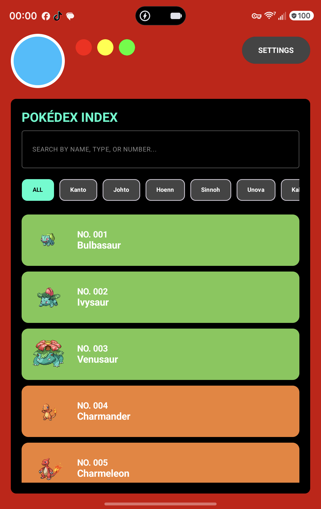 | 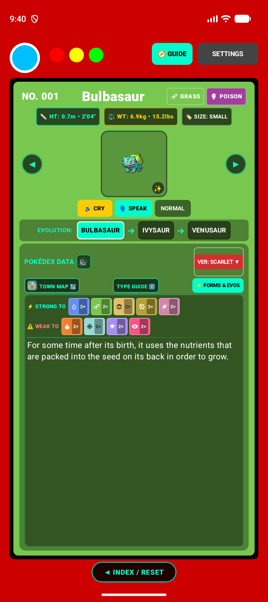 | 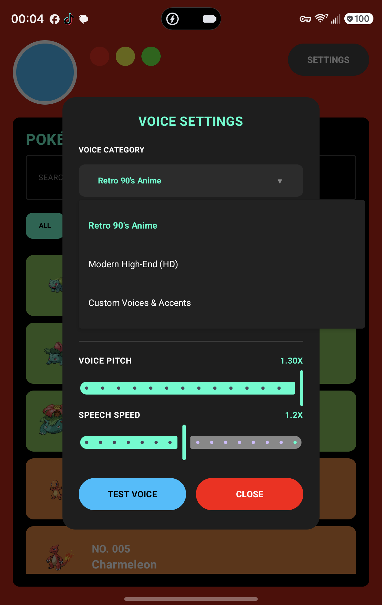 |

Bori-dex's camera scanner is powered by a **Stage 11 MobileNetV2 Float32 neural network** trained on **972,891 images** across all **1,025 Pokémon species**—including plushies, holographic trading cards (such as *Trick or Trade* Halloween holos), unpainted 3D resin/filament prints, *Pokémon Sleep* figures, and Nintendo Switch / 3DS / Game Boy screens.

### Step-by-Step Scanning Workflow:
1. **Open the Scanner**:
   - Tap the **Blue Scanner Lens** at the top-left of the Pokédex header (or tap **`📷 SCAN`** from the index).
2. **Frame Your Pokémon Inside the 240dp Cybernetic Reticle**:
   - Hold your phone ~6–14 inches away from the Pokémon plushie, card, figure, 3D print, or screen.
   - Center the Pokémon inside the **rounded cyan targeting brackets** (`240dp × 240dp`). The camera analyzer automatically crops to the exact optical center of the reticle (`44.1%` vertical offset) so what you frame inside the brackets is 1:1 what the AI evaluates.
   - Use the **Quick-Zoom Dock** (`1.0×`, `1.5×`, `2.0×`) or pinch-to-zoom on the camera preview if scanning small figures or distant TV/Switch screens.
3. **Watch the 5-Tier Temporal Consensus Bar Lock In**:
   - Instead of guessing on a single blurry frame, Bori-dex averages rolling probability distributions across **up to 22 frames**:
     - **Tier 1 (High Confidence ≥ 65%)**: Locks in **8 frames (~0.5 seconds)**.
     - **Tier 2 (Clear Match ≥ 40%)**: Locks in **10 frames (~0.6 seconds)**.
     - **Tier 3–4 (Moderate Lighting ≥ 22%–26%)**: Locks in **12–14 frames (~0.8–0.9 seconds)**.
     - **Tier 5 (Dim Room / Low-Light ≥ 17% with 2.5× dominance)**: Locks in **16 frames (~1.0 second)**.
   - **Holographic & Glare Protection**: Built-in specular reflection suppression prevents shiny foil card wrappers or glass display cases from triggering false bug/light predictions.
4. **Experience the *"Who's That Pokémon?!"* Commercial Reveal**:
   - Once consensus locks, Bori-dex plays the iconic 6-note 1997 anime commercial bumper arpeggio (`C5 -> E5 -> G5 -> C6 -> E6 -> G6`), displays the bouncing silhouette, reveals the identified Pokémon with its authentic anime cry, and reads its Pokédex entry aloud in Dexter's robotic voice!

---

## 3. Navigating the Pokédex Index & Entry Terminal

| Alternate Forms & Megas | Regional Filter (Johto) | Voice & DSP Configuration |
| :---: | :---: | :---: |
| 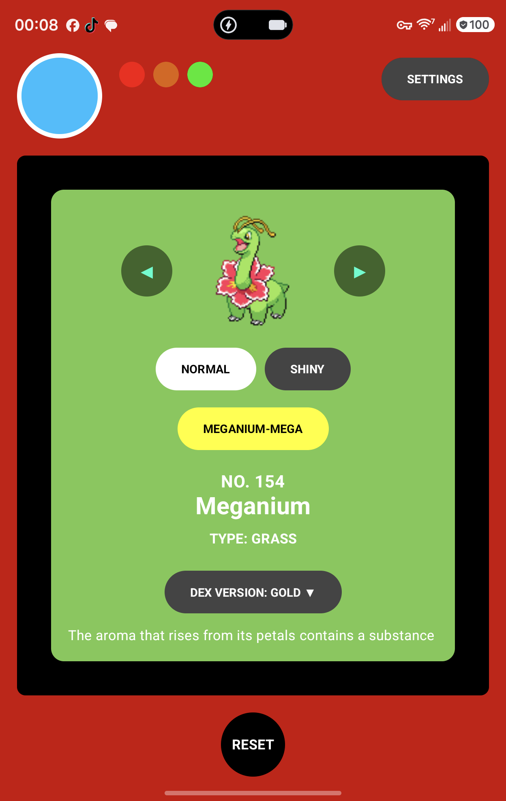 | 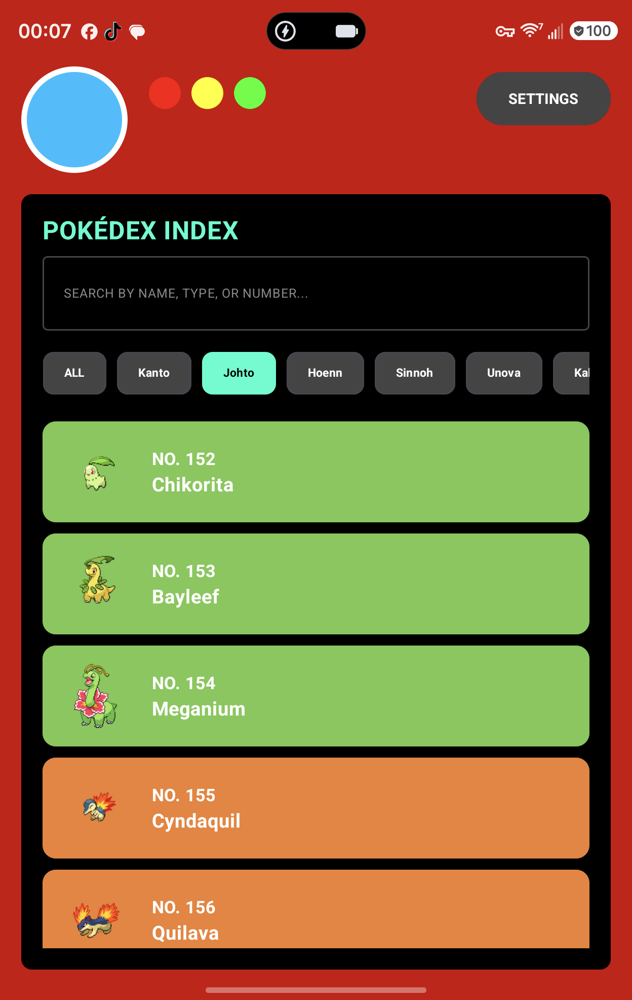 | 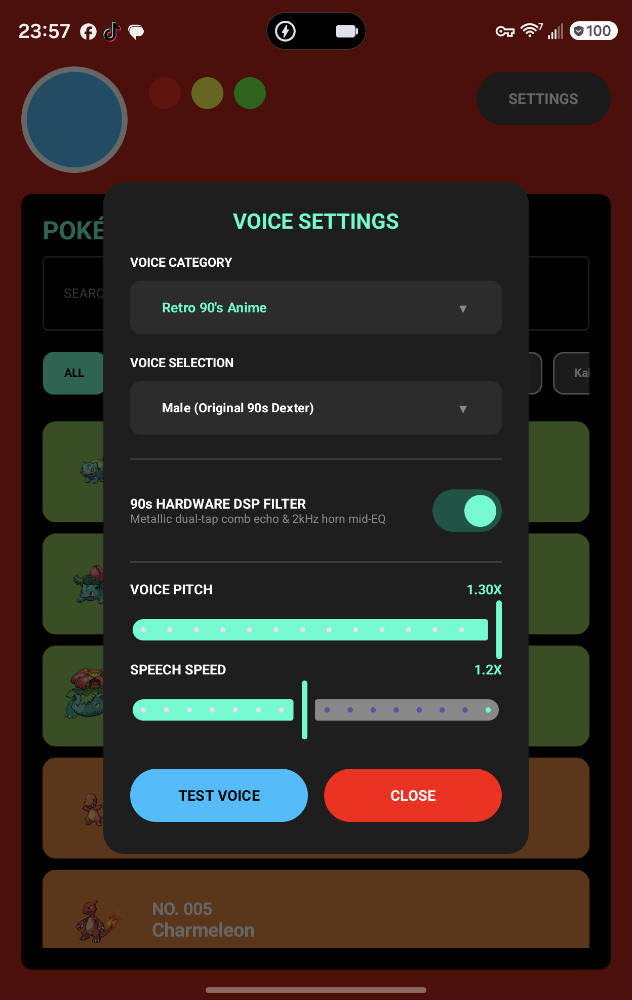 |

### A. Searching & Filtering the 1,025-Species Index
- **Search Bar**: Type any Pokémon's name (`"Pikachu"`, `"Rayquaza"`, `"Flabébé"`), partial name, or National Pokédex number (`"#025"`, `"150"`, `"1025"`).
- **Region Filter Chips**: Tap any region chip below the search bar to filter by generation/region:
  - `ALL MAPS` (*National Pokédex #001–#1025*)
  - `Kanto` (#001–#151) • `Johto` (#152–#251) • `Hoenn` (#252–#386) • `Sinnoh` (#387–#493)
  - `Unova` (#494–#649) • `Kalos` (#650–#721) • `Alola` (#722–#809) • `Galar` (#810–#898)
  - `Hisui` (#899–#905 + Hisuian Forms) • `Paldea` (#906–#1025 + Paldean/Paradox Forms)

### B. Using the Upper Monitor Stage (Detail View)
When you tap any Pokémon (or after a camera scan locks in), the **Upper Monitor Stage** displays:
1. **Title & Elemental Badges**: Canonical National Dex number (`NO. 001`), species name, and elemental type pills (`[GRASS] [POISON]`).
2. **Physical Specifications Telemetry Row**:
   - **`📏 HT`**: Dual metric and imperial height (`HT: 0.7m • 2'04"`).
   - **`⚖️ WT`**: Dual metric and imperial weight (`WT: 6.9kg • 15.2lbs`).
   - **`🏷️ SIZE`**: Automatic anatomical size classification (`TINY`, `SMALL`, `MEDIUM`, `LARGE`, or `GIGANTIC`).
3. **Interactive Sprite Stage & Edge Pagination**:
   - Tap **`◀`** or **`▶`** on the left/right edges of the monitor to flip sequentially through the National Pokédex (`#001` $\leftrightarrow$ `#1025`).
   - Moving **forward (`▶`)** automatically triggers Dexter's voice narration; moving **backward (`◀`)** stays quiet so you can browse back without interruption.
4. **Audio, Shiny & Form Controls**:
   - **`🔊 CRY`**: Plays the Pokémon's authentic offline sound cry.
   - **`🗣 SPEAK`**: Replays Dexter's spoken narration of the active Pokédex entry at any time.
   - **`NORMAL` / `★ SHINY`**: Toggles between standard and shiny (`✨`) artwork/sprites.
   - **Form Chips**: For species with Mega Evolutions, Gigantamax, Alolan, Galarian, Hisuian, or Paldean variants, tap the form chips directly beneath the monitor to switch forms live.

### C. Reading the Pokédex Data Terminal
Below the monitor stage sits the dark **Pokédex Data Terminal**:
- **Header Row 1**: Displays `POKÉDEX DATA`, quick speaker replay (`🔊`), and the active **Game Cartridge Selector (`VER: <EDITION> ▼`)**.
- **Header Row 2 (Quick Modal Launchers)**:
  - **`TOWN MAP 🗺️`**: Opens the interactive regional habitat map for the current Pokémon and game cartridge.
  - **`TYPE GUIDE ℹ️`**: Opens the full interactive offensive/defensive elemental type matchup matrix.
  - **`⚡ FORMS & EVOS`**: Opens the canonical, game-specific evolution lineage and form requirements modal.
- **Combat Matchup Telemetry**:
  - **`⚡ STRONG TO`**: Shows every elemental type this Pokémon's STAB (Same-Type Attack Bonus) attacks hit for `2×` super-effective damage.
  - **`⚠️ WEAK TO`**: Shows every elemental type that hits this Pokémon for `2×` or quad `4×` super-effective damage.
- **Scrollable Canonical Game Lore**: Pure official Pokédex flavor text from the selected game cartridge, with spacious vertical room for effortless reading.

---

## 4. Switching Across All 37 Tactile Retro Game Cartridges & Dynamic Evolutions

Bori-dex includes **37 authentic tactile retro game cartridges** spanning every mainline release from Generation 1 to Generation 9, plus **Pokémon GO**:

| Generation | Supported Game Cartridges (`VER: <EDITION> ▼`) |
| :--- | :--- |
| **Gen I (Kanto)** | `Red`, `Blue`, `Yellow` |
| **Gen II (Johto)** | `Gold`, `Silver`, `Crystal` |
| **Gen III (Hoenn & Kanto)** | `Ruby`, `Sapphire`, `Emerald`, `FireRed`, `LeafGreen` |
| **Gen IV (Sinnoh & Johto)** | `Diamond`, `Pearl`, `Platinum`, `HeartGold`, `SoulSilver` |
| **Gen V (Unova)** | `Black`, `White`, `Black 2`, `White 2` |
| **Gen VI (Kalos & Hoenn)** | `X`, `Y`, `Omega Ruby`, `Alpha Sapphire` |
| **Gen VII (Alola & Kanto)** | `Sun`, `Moon`, `Ultra Sun`, `Ultra Moon`, `Let's Go Pikachu`, `Let's Go Eevee` |
| **Gen VIII (Galar, Sinnoh & Hisui)** | `Sword`, `Shield`, `Brilliant Diamond`, `Shining Pearl`, `Legends: Arceus` |
| **Gen IX (Paldea & Kalos)** | `Scarlet`, `Violet`, `Legends: Z-A` |
| **Mobile / Spin-Off** | `Pokémon GO` |

### What Happens When You Switch Cartridges?
Tapping **`VER: <EDITION> ▼`** (in the Pokédex Terminal, Evolution Modal, Town Map, or Strategy Guide) opens the tactile cartridge grid—complete with molded plastic shell colors, top grip ridges, foil stickers, and mascot sprites. Selecting a cartridge immediately updates **four systems simultaneously**:
1. **Pokédex Lore & Voice Narration**: Loads the exact historical Pokédex entry from that game cartridge and narrates it via Dexter.
2. **Dynamic Evolution Requirements (`⚡ FORMS & EVOS`)**:
   - *Example — Feebas $\rightarrow$ Milotic*:
     - Select **`Sapphire` / `Emerald`**: Shows **Level up with High Beauty ($\ge 170$)** using Dry **Pokéblocks** (`pokeblock.png`).
     - Select **`Diamond` / `Platinum` / `Brilliant Diamond`**: Shows **Level up with High Beauty ($\ge 170$)** using Dry **Poffins** (`poffin.png`).
     - Select **`Scarlet` / `Violet`**: Shows **Trade holding a Prism Scale** (`prism-scale.png`).
   - *Example — Kadabra / Haunter / Machoke / Graveler*:
     - Select **`Red` / `Emerald` / `Scarlet`**: Shows **Link Trade** (`link-cable.png`).
     - Select **`Legends: Arceus`**: Shows **Use a Linking Cord** item (`linking-cord.png`) with zero trading required!
   - *Example — Pokémon GO*: Shows exact **GO Candy** counts (`25`, `50`, `100`, `400`), **Sinnoh Stone / Unova Stone**, **Lure Modules** (Glacial, Mossy, Magnetic, Rainy), and buddy adventure requirements.
3. **Regional Town Map & Wild Spawns (`TOWN MAP 🗺️`)**: Switches to that cartridge's authentic regional map (including native ROM pixel art for GB/GBC/GBA titles) and filters wild encounters to that exact version.
4. **Strategy Guide Pinpoints (`🧭 GUIDE`)**: Tailors every item location, roadblock walkthrough, Master Ball recommendation, and map pin to that exact game edition.

---

## 5. Interactive Regional Town Maps & Habitat Tracker (`TOWN MAP 🗺️`)

Tap **`TOWN MAP 🗺️`** on any Pokémon entry to open the interactive habitat tracker:
1. **Wild Habitat Pins & Encounter Breakdown**:
   - Glowing cyan radar pins highlight every route, town, cave, and water body where the Pokémon spawns in the active cartridge.
   - Displays encounter methods (**Walking / Grass**, **Surfing**, **Old / Good / Super Rod Fishing**, **Rock Smash**, **Headbutt**, **Static / Story Encounter**) and spawn percentages.
   - **Canonical Legendary Quarantine**: Region-exclusive Legendaries, Mythicals, Ultra Beasts, and Paradox Pokémon are strictly quarantined to their canonical regions and static story encounters (e.g., querying Yveltal in Hoenn correctly shows `Area Unknown` with a one-tap jump chip to its native `Kalos` Team Flare HQ encounter).
2. **Interactive Landmark Layers (`🏷️ LAYERS (7/7) ▼`)**:
   - Toggle visibility across 7 landmark categories: **Towns (`🏠`)**, **Cities (`🏛️`)**, **Routes (`R1`, `R104`)**, **Caves & Dungeons**, **Waterways**, **Points of Interest (`📍`)**, and **Gyms / Trials**.
   - **Tap Any Landmark Badge on the Map**: Opens the **Landmark Inspector Card** showing its tagline, description, key items/locations, connected areas (tap any connected area chip to jump the camera pin directly to it!), and strategy advice.
3. **Full-Screen Pinch-to-Zoom (`⛶ TAP TO EXPAND`)**:
   - Tap **`⛶ TAP TO EXPAND`** to open the full-screen map modal with smooth multi-touch pinch-to-zoom and panning where all route shields and town badges scale dynamically.
4. **Game Boy Hardware Palette Switcher (Gen 1 Kanto Maps)**:
   - When viewing Gen 1 Kanto (`Red`, `Blue`, `Yellow`), tap the **PALETTE** bar above the map to switch live between 5 authentic hardware color palettes:
     - `Pocket (B&W)` • `DMG (Classic Olive Green)` • `GBC Red` • `GBC Blue` • `Super GB`

---

## 6. Mastering Dexter's Ultimate Game Strategy Guide (`🧭 GUIDE`)

| Strategy Guide Welcome Hub | All 28 Poké Balls & Capture | Area Zero Regional Encyclopedia |
| :---: | :---: | :---: |
| 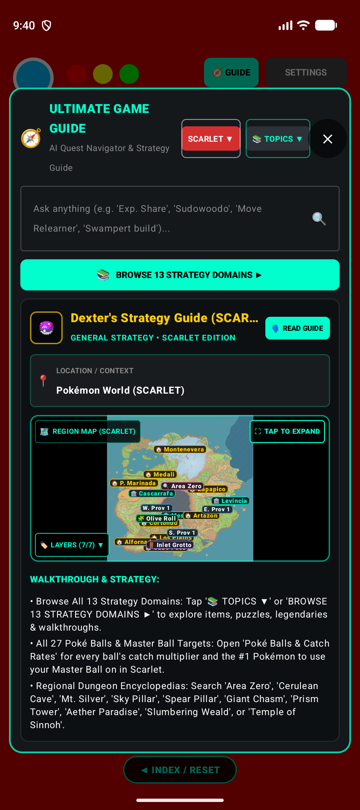 | 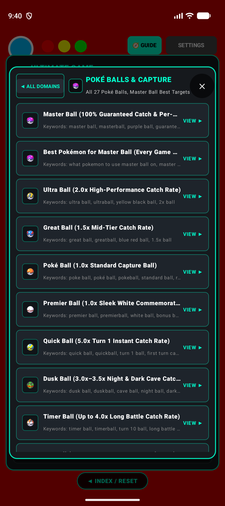 | 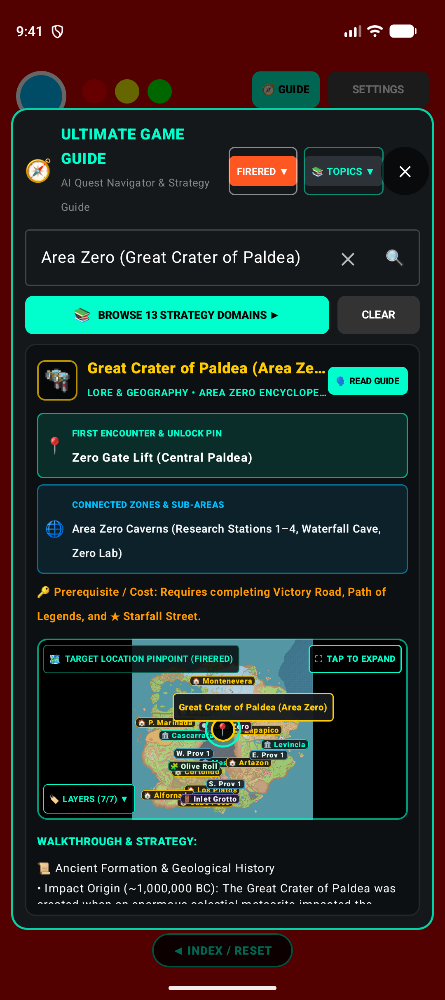 |

| Master Ball Target (Scarlet) | Master Ball Target (FireRed Roar Bug) | Main Terminal & Quick Launchers |
| :---: | :---: | :---: |
| 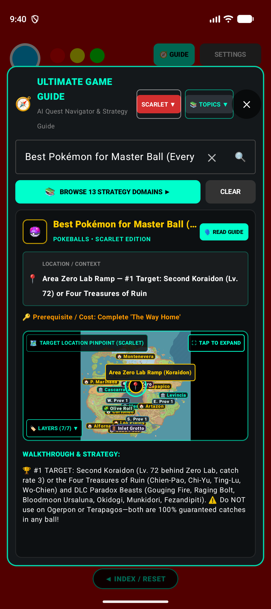 | 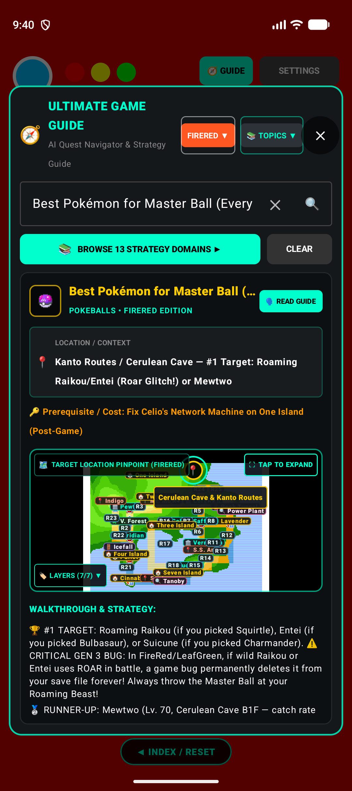 |  |

Tap **`🧭 GUIDE`** in the top Pokédex header at any time to open the **Ultimate Game Guide**—an offline AI Quest Navigator & Strategy Encyclopedia covering all 37 mainline cartridges.

### A. Three Ways to Find Any Answer Instantly
1. **Natural Language Search Bar**:
   - Type any question, item, Pokémon, puzzle, or dungeon in the search box and press **`🔍`**:
     - *Items & Balls*: `"Master Ball"`, `"Exp. Share"`, `"Leftovers"`, `"Amulet Coin"`, `"Ability Patch"`, `"Bicycle"`, `"Flame Orb"`
     - *Roadblocks & Story Quests*: `"Sudowoodo"`, `"Snorlax"`, `"Psyduck"`, `"Silph Co"`, `"Devon Goods"`
     - *Dungeons & Lore Encyclopedias*: `"Area Zero"`, `"Great Crater of Paldea"`, `"Cerulean Cave"`, `"Mt. Silver"`, `"Sky Pillar"`, `"Spear Pillar"`, `"Distortion World"`, `"Crown Tundra"`
     - *Competitive & In-Game Builds*: `"Swampert build"`, `"Garchomp moveset"`, `"Charizard EV"`
2. **Browse All 13 Strategy Domains (`📚 TOPICS ▼` / `BROWSE 13 STRATEGY DOMAINS ▶`)**:
   Tap **`📚 TOPICS ▼`** or the cyan **`BROWSE 13 STRATEGY DOMAINS ▶`** bar to open the visual domain grid with pixel item icons:

   | # | Strategy Domain | What It Covers |
   | :---: | :--- | :--- |
   | **1** | **Healing Items** | Potions, Hyper/Max Potion, Full Restore, Revive, Max Revive, Sacred Ash, Status Heals, Moomoo Milk, Lemonade & Berries |
   | **2** | **Key Items** | Bicycle, Running Shoes, Old/Good/Super Fishing Rods, Silph Scope, Devon Scope, Poké Flute, SquirtBottle & SecretPotion |
   | **3** | **Money Items** | Amulet Coin, Luck Incense, Nugget, Big Nugget, Big Pearl, Star Piece, Comet Shard & Relic Gold farming |
   | **4** | **Event Items** | Old Sea Map, Eon Ticket, Aurora Ticket, Mystic Ticket, Member Card, Oak's Letter, Azure Flute & Liberty Pass |
   | **5** | **Evolution & Trade** | All Evolution Stones (Fire, Water, Thunder, Leaf, Moon, Sun, Shiny, Dusk, Dawn, Ice), Metal Coat, King's Rock, Dragon Scale, Link Cable & Linking Cord |
   | **6** | **Battle & Held Items** | Exp. Share, Leftovers, Choice Band/Specs/Scarf, Focus Sash, Life Orb, Assault Vest, Heavy-Duty Boots, Eviolite & Ability Patch |
   | **7** | **Poké Balls & Capture (28 Guides)** | All 27 Poké Balls (Catch Multipliers & Earliest Mart Unlocks) + **Best Pokémon for Master Ball (Every Game)** |
   | **8** | **Missions & Roadblocks** | Route 36 Sudowoodo, Route 11/12/16 Snorlax, Route 210 Psyduck Headache, Route 110 Blockade, Devon Goods, Silph Co. & Power Plant Machine Part |
   | **9** | **Hidden Items & Dowsing** | Dowsing Machine / Itemfinder radar spots, Hidden Rare Candies, PP Max, Buried Fossils & Daily Berry Trees |
   | **10** | **Braille & Secret Ciphers** | Hoenn Sealed Chamber Braille alphabet, Johto Ruins of Alph sliding stones, Sevii Tanoby Chambers & Unova Abyssal Ruins cipher |
   | **11** | **Legendary Encounters** | Step-by-step capture quests for Mewtwo, Kanto Birds, Weather Trio (Rayquaza/Groudon/Kyogre), Regi Trio, Creation Trio & Treasures of Ruin |
   | **12** | **Event Pokémon & Myths** | Mew (Faraway Island), Celebi (Ilex Shrine), Jirachi, Deoxys (Birth Island Triangle Puzzle), Darkrai, Shaymin, Arceus & Pecharunt |
   | **13** | **Puzzles & Dungeons (+ 10 Regional Encyclopedias)** | Trick House Rooms 1–8, Ice Path Sliding, Lt. Surge Trash Cans, Silph Co. / Sabrina Warp Mazes, Sootopolis Ice Tiles + **All 10 Regional Dungeon Encyclopedias** |

3. **Switch Game Cartridge Live (`SCARLET ▼` / `FIRERED ▼`)**:
   - Tap the colored cartridge button in the top bar of the Guide modal to switch editions on the fly. The walkthrough steps, prerequisites, target recommendations, and **Target Location Pinpoint** map automatically update to match your selected game!

### B. Using the Poké Balls & Per-Game Master Ball Target Guides
Inside **Domain 7 (`Poké Balls & Capture`)**, you have dedicated guides for all **27 Poké Balls** plus the flagship **`Best Pokémon for Master Ball (Every Game)`** topic:
- **Standard & Specialty Poké Balls**: Shows exact catch rate formulas (e.g., `Quick Ball = 5.0× on Turn 1`, `Dusk Ball = 3.0× in caves/night`, `Timer Ball = 4.0× by Turn 10`, `Ultra Ball = 2.0×`, `Heavy Ball`, `Fast Ball`, `Lure Ball`, `Moon Ball`, `Love Ball`, `Friend Ball`, `Level Ball`, `Dream Ball`, `Beast Ball = 5.0× on Ultra Beasts / 0.1× on standard Pokémon`) alongside two progression banners for Mart-stocked balls:
  - **`📍 FIRST ENCOUNTER & UNLOCK PIN`**: Pinpoints the earliest town/mart where the ball can be obtained.
  - **`🌐 REGION-WIDE MART PROGRESSION`**: Explains which Gym badge milestone unlocks the ball across all Poké Marts in that region (never shown on unique non-Mart balls like the Master Ball or Apricorn Balls).
- **Per-Game Master Ball Target Strategy**: Select your game cartridge (`Red`, `FireRed`, `Emerald`, `HeartGold`, `Platinum`, `Black`, `X`, `Ultra Sun`, `Sword`, `Legends: Arceus`, `Scarlet`, etc.) to see the #1 mathematically optimal Master Ball target, runner-up targets, and critical game bug warnings:
  - **FireRed / LeafGreen (`⚠️ CRITICAL GEN 3 BUG`)**: Warns you to save your Master Ball for **Roaming Raikou** (if you picked Squirtle) or **Roaming Entei** (if you picked Bulbasaur)—because in FireRed/LeafGreen, if wild Raikou or Entei uses the move **Roar** in battle, a notorious Gen 3 programming bug permanently deletes the Pokémon from your save file forever!
  - **Scarlet / Violet (`⚠️ GUARANTEED CATCH WARNING`)**: Directs your Master Ball to the **Second Koraidon / Miraidon** (`Lv. 72`, catch rate `3` at the bottom of Area Zero Lab Ramp) or the **Four Treasures of Ruin** (`Chien-Pao`, `Chi-Yu`, `Ting-Lu`, `Wo-Chien`), and explicitly warns you **NOT** to waste your Master Ball on **Ogerpon** or **Terapagos** (both are 100% guaranteed story catches in any decorative ball!).

### C. Exploring the 10 Regional Dungeon Encyclopedias
Inside **Domain 13 (`Puzzles & Dungeons`)**—or by typing the dungeon's name into the Guide search bar—you can open full multi-section encyclopedias for the 10 most iconic end-game zones in Pokémon history:
1. **Great Crater of Paldea (Area Zero)** (*Scarlet / Violet*): ~1,000,000 BC meteorite origin, Heath's Scarlet/Violet Book expedition, Professor Sada/Turo & the Time Machine, Research Stations 1–4 override locks, all 16 Paradox Pokémon spawn tables by elevation, and secret Roaring Moon / Iron Valiant waterfall cave.
2. **Cerulean Cave / Unknown Dungeon** (*Red / Blue / Yellow / FireRed / LeafGreen / HGSS / Let's Go*): Post-game Sevii Islands Network Machine unlock, 1F/2F/B1F navigation, Lv. 70 Mewtwo encounter, and invisible Berserk Gene / Master Ball item spots.
3. **Mt. Silver Cave** (*Gold / Silver / Crystal / HeartGold / SoulSilver*): 16-Badge Oak authorization, Flash/Waterfall ascent, wild Larvitar/Pupitar/Misdreavus spawns, and the ultimate summit battle against **Champion Red** (Lv. 81–88 Pikachu, Charizard, Blastoise, Venusaur, Snorlax, Espeon/Lapras).
4. **Sky Pillar** (*Ruby / Sapphire / Emerald / Omega Ruby / Alpha Sapphire*): Sootopolis crisis unlock, Mach Bike 3-tile cracked floor timing puzzle on 2F & 4F, Lv. 70 **Rayquaza** summit encounter, and ORAS Delta Episode **Deoxys** space battle.
5. **Spear Pillar & Distortion World** (*Diamond / Pearl / Platinum / Brilliant Diamond / Shining Pearl*): Mt. Coronet dual-entrance climb, Team Galactic Commander double battle, Dialga/Palkia awakening, and Platinum's anti-gravity **Distortion World** boulder puzzle & Lv. 47 **Giratina Origin Forme**.
6. **Giant Chasm** (*Black / White / Black 2 / White 2*): Crater forest puzzle, Plasma Frigate infiltration, Ghetsis & Black/White Kyurem climax, and post-game Lv. 70 **Kyurem** & **DNA Splicers**.
7. **Terminus Cave** (*X / Y*): Route 18 abandoned coal mine maze, Durant/Noibat ambush spawns, post-game Deepest Chamber Lv. 70 **Zygarde (50% Forme)**, and Adamant/Lustrous/Griseous Orbs.
8. **Ultra Space & Resolution Cave** (*Sun / Moon / Ultra Sun / Ultra Moon*): Poni Meadow & Resolution Cave depths (Guzzlord), plus Ultra Warp Ride wormhole color guide (`White` = Ultra Beasts, `Red` = Flying Legends, `Blue` = Water/Ground Legends, `Green` = Land Legends, `Yellow` = Cave Legends) and 4-ring distance mechanics.
9. **The Crown Tundra & Max Lair** (*Sword / Shield*): Peony's 3 Legendary Clues (*The Sacred Bonds of Sovereign and Steed* for Calyrex + Glastrier/Spectrier, *The Terrible Titans* for Regieleki/Regidrago, *A Legendary Tree of a Legendary Three* for Galarian Birds) and **Dynamax Adventures** (`100% catch rate` in any Poké Ball + `1/100` Shiny odds with Shiny Charm!).
10. **Coronet Highlands & Temple of Sinnoh** (*Legends: Arceus*): Wayward Cave, Fabled Spring, Sacred Plaza, Origin Ore acquisition, the **Origin Ball**, Dialga/Palkia Origin Forme balms, and seeking all 18 Plates to confront **Arceus** atop the Hall of Origin.

> [!TIP]
> **Hands-Free Voice Walkthrough (`🗣 READ GUIDE`)**: On any Strategy Guide or Regional Encyclopedia entry, tap the cyan **`🗣 READ GUIDE`** button at the top right of the card to have Dexter read the complete strategy briefing aloud while you play!

---

## 7. Customizing Dexter's Voice, DSP & Foldable Display Modes (`⚙️ SETTINGS`)

Tap **`⚙️ SETTINGS`** in the top-right header to open the 3-tab settings dialog:
1. **`VOICE` Tab**:
   - **Voice Profiles**:
     - *Retro 90s Anime (Male — Original Dexter)*: Calibrated pitch (`1.15×`) and speed (`1.12×`) with hardware DSP metallic echo.
     - *Retro 90s Anime (Female)*: High-clarity retro anime female narrator.
     - *Modern HD (Male / Female)*: Clean studio narration without metallic room echo.
     - *Custom Regional Accents*: Select from system-installed English accents (*American, British, Australian, Indian, Irish, Canadian, etc.*).
   - **Hardware DSP Filter Toggle**: Enables/disables the 260 Hz high-pass filter, +5 dB 2000 Hz transistor mid-EQ boost, 4200 Hz retro low-pass rolloff, and dual-tap 12ms/24ms metallic comb echo.
2. **`SOUND & SCAN` Tab**:
   - Toggle **Anime Cries on Entry Open**, **"Who's That Pokémon?!" Bumper Audio**, **Directional Auto-Speech** (speak on forward page turn, silent on back), and **Scanner Auto-Lock Sensitivity**.
3. **`GAME VERSION` Tab**:
   - Set your default preferred cartridge across all 37 editions.
4. **Using Bori-dex on Foldable Phones (Galaxy Z Fold / Pixel Fold)**:
   - **Folded Cover Screen Mode (`< 600dp`)**: Automatically scales the header lens (`50dp`), monitor stage (`110dp`), and toolbars (`28dp`) to reclaim **~114dp (~300px)** of vertical screen height so the Pokédex lore terminal stays spacious and unclipped.
   - **Unfolded Dual-Screen Mode (`>= 600dp`)**: Automatically expands into a **Silph Co. Dual-Screen Pokédex** with a realistic central metallic hardware hinge (**`PokedexFoldHinge`**), keeping the Master Pokédex Index / Scanner on the left pane and the live Detail Monitor / Town Map on the right pane!

---
---

# Part II: The Owner & Developer's Manual (Building, Extending & Training)

This section is your personal engineering handbook for maintaining, testing, deploying, and expanding Bori-dex on your workstation (`D:\Code\Bori-Dex`).

## 1. Complete Workspace & Directory Map

```text
D:\Code\Bori-Dex\
├── Pokemon_ref_games_backup\                         # 36 Authentic Game ROMs (GB/GBC/GBA/NDS/N64/GC/3DS/Switch, 29.76 GB)
└── Pokedex\
    ├── pokemon guides\                               # 26 Official Strategy Guide PDFs + Web Walkthrough Hotlinks
    │   ├── all web guides hotlinks.txt               # 40+ Bulbapedia, Serebii, Marriland & IGN canonical URLs
    │   └── *.pdf                                     # Prima, BradyGames, Nintendo Power & Official Guidebooks
    │
    ├── refnotes\                                     # Local Session Architecture Ledger & Expert Reports
    │   ├── session_memory.md                         # Master chronological memory ledger (Sessions 1–68)
    │   ├── session_66_master_guide_sources_architecture_and_pipeline.md
    │   ├── session_67_complete_codebase_architecture_and_system_expert_report.md
    │   └── session_68_complete_user_and_developer_tutorial.md
    │
    ├── scripts\                                      # Single-Command Automation & Device Scripts (Rule 7)
    │   ├── install_phone.py                          # Detects physical phone (SM-F971U), installs APK, verifies logcat
    │   ├── test_emu_guide.py                         # Full emulator UI test driver + 7 guide verification screenshots
    │   ├── capture_and_prep_release.py               # Builds APK, captures docs/screenshots/*, runs 136 unit tests
    │   └── ingest_and_build_encyclopedia.py          # Compiles regional dungeon encyclopedias into JSON assets
    │
    └── PokedexApp\                                   # Git Repository Root (https://github.com/Atom0131/Bori-dex.git)
        ├── app\
        │   ├── build.gradle.kts                      # compileSdk 36, minSdk 24, versionCode 16, versionName "1.9.9"
        │   └── src\
        │       ├── main\
        │       │   ├── assets\
        │       │   │   ├── model.tflite              # Stage 11 Float32 MobileNetV2 (14.1 MB, 1,025 classes)
        │       │   │   ├── labels.txt                # 1,025 canonical species class labels
        │       │   │   ├── pokemon_data.json         # National Dex #001-#1025 stats, types, forms & multi-game lore
        │       │   │   ├── pokemon_encounters.json   # Gen 1-9 wild habitat spawn tables & methods
        │       │   │   ├── pokemon_pronunciations.json # 1,834 phonetic anime respellings
        │       │   │   ├── game_guides_index.json    # 13 Strategy Domains, 84+ topics, 28 Poké Balls, builds & gyms
        │       │   │   ├── game_guides\              # 10 Regional Dungeon Encyclopedias (*.json)
        │       │   │   ├── maps\                     # 11 Regional Town Maps (ROM pixel art & HD maps)
        │       │   │   ├── items\                    # 150+ 8-bit/16-bit pixel item sprites (*.png)
        │       │   │   └── sounds\                   # 1,025 offline Pokémon cry audio files (*.ogg)
        │       │   └── java\com\example\pokedex\
        │       │       ├── camera\                   # PokedexImageAnalyzer, TFLiteClassifier, PokemonFormDetector
        │       │       ├── tts\                      # DexterAudioDsp, OfflineTTS, PokemonPronunciation, VoiceProfile
        │       │       ├── data\                     # PokedexDatabase, PokemonGameGuideRepository, EvolutionGuide, RegionMapLandmarks
        │       │       ├── viewmodel\                # PokedexViewModel (StateFlows, 22-frame consensus voter, guide search)
        │       │       └── ui\                       # PokedexScreen.kt (10,063 lines: Adaptive M3 UI, 37 Cartridges, Modals)
        │       └── test\java\com\example\pokedex\    # 136 JVM Unit Tests (Guide, Landmarks, Consensus, Habitation)
        ├── docs\
        │   ├── USER_AND_DEVELOPER_TUTORIAL.md        # This complete tutorial (tracked in Git)
        │   ├── TRAINING_PIPELINE.md                  # Deep-dive ML training documentation
        │   └── screenshots\                          # High-resolution app screenshots for README & Play Store
        ├── README.md
        ├── RELEASE_NOTES.md
        └── CHANGELOG.md
```

---

## 2. Daily Build, Test & Deployment Cheat Sheet

All commands below can be run directly from PowerShell in `D:\Code`:

### A. Run All 136 JVM Unit Tests
Verifies 100% of the 13 Strategy Domains, 28 Poké Balls, Per-Game Master Ball Targets, 10 Regional Dungeon Encyclopedias, 11 Regional Map Landmark sets, and the 22-Frame Consensus Voter:
```powershell
D:\Code\Bori-Dex\Pokedex\PokedexApp\gradlew.bat -p D:\Code\Bori-Dex\Pokedex\PokedexApp testDebugUnitTest
```

### B. One-Command Install & Launch on Your Physical Phone (`SM-F971U` Galaxy Z Fold)
Automatically finds your connected physical phone (ignoring emulators), builds `app-debug.apk` if needed, performs a streamed ADB install, grants camera permissions, launches `MainActivity`, and verifies zero crashes in `logcat`:
```powershell
python D:\Code\Bori-Dex\Pokedex\scripts\install_phone.py
```

### C. One-Command Emulator Verification & Screenshot Suite
Builds and installs the APK onto the Android emulator (`emulator-5554`), navigates the UI automatically via `uiautomator` XML bounds parsing, tests the Strategy Guide, Poké Balls, Master Ball targets, Cartridge Switcher, and Regional Encyclopedias, captures screenshots, and checks `logcat`:
```powershell
python D:\Code\Bori-Dex\Pokedex\scripts\test_emu_guide.py
```

### D. Full Release Prep (Update `docs/screenshots/` + Run Unit Tests + Verify Emulator)
```powershell
python D:\Code\Bori-Dex\Pokedex\scripts\capture_and_prep_release.py
```

---

## 3. How to Add or Update Strategy Guides, Poké Balls & Map Pinpoints

### A. Adding or Editing a Strategy Guide Topic (`game_guides_index.json`)
Open [`app/src/main/assets/game_guides_index.json`](../app/src/main/assets/game_guides_index.json):
1. **Add the Topic ID to its Category in `"categories"`**:
   - Each of the 13 categories has a `"topicIds"` array (e.g., `"pokeballs"`, `"key_items"`, `"puzzles_dungeons"`).
   - *Important*: `PokemonGameGuideTest` enforces a strict contract that every ID in `"topicIds"` resolves to a valid topic and that `cat.topicIds.size == getTopicsForCategory(cat.id).size`.
2. **Add the Topic Object under `"topics"`**:
   ```json
   "my_new_topic": {
     "id": "my_new_topic",
     "name": "Display Title of Topic",
     "categoryId": "key_items",
     "aliases": ["keyword 1", "keyword 2"],
     "versions": {
       "FireRed": {
         "location": "Celadon City Condominiums — Exact Context",
         "pinArea": "Celadon City",
         "prerequisites": "Badge or Quest Requirement",
         "instructions": "1. Step one...\n2. Step two...",
         "mapAsset": "kanto_frlg.png"
       }
     }
   }
   ```
3. **Assign an 8-Bit Pixel Icon**:
   - In [`PokemonGameGuideRepository.kt`](../app/src/main/java/com/example/pokedex/data/PokemonGameGuideRepository.kt), add `"my_new_topic" to "item-sprite.png"` inside `TOPIC_ITEM_ICONS` (using any PNG from `app/src/main/assets/items/`).
   - If the topic is a unique/non-Mart item, add its keyword to `nonMartKeywords` in `resolveMartProgression()` so it never displays a generic Poké Mart progression banner.

### B. Adding or Updating a Regional Dungeon Encyclopedia (`assets/game_guides/*.json`)
1. Each of the 10 major dungeons lives in its own JSON file inside [`app/src/main/assets/game_guides/`](../app/src/main/assets/game_guides/) and is indexed in [`regional_encyclopedia_index.json`](../app/src/main/assets/game_guides/regional_encyclopedia_index.json).
2. `PokemonGameGuideRepository.queryEncyclopedia()` automatically checks `regional_encyclopedia_index.json` first (`Priority 0`), formatting multi-section lore, elevation spawn tables, key items, and `spoken_narration` for Dexter's TTS voice.

### C. Adding Map Pin Coordinates (`RegionMapLandmarks.kt` & `PokemonGameGuideRepository.kt`)
- Normalized map coordinates `(xNorm, yNorm)` range from `0.0f` (top/left edge) to `1.0f` (bottom/right edge).
- To add a new clickable town, route, or dungeon badge on a region map, add a `MapLandmark(...)` entry to that region's list in [`RegionMapLandmarks.kt`](../app/src/main/java/com/example/pokedex/data/RegionMapLandmarks.kt).
- To add custom quest pinpoint overrides (such as Faraway Island, Birth Island, or Zero Gate), add the keyword mapping in `PokemonGameGuideRepository.resolveMapCoordinates()`.

---

## 4. How to Retrain & Export the On-Device Vision Model (Float32 TFLite)

Bori-dex's vision model (`app/src/main/assets/model.tflite`) is a **MobileNetV2** classifier trained across **11 progressive stages** on **972,891 images** covering all **1,025 Pokémon classes** (`labels.txt`).

### Critical Engineering Guardrail: Never Use INT8 Quantization!
- Across 1,025 fine-grained classes, uniform random chance is $1 / 1025 \approx 0.098\%$.
- Post-training `INT8` quantization causes a **6× confidence collapse** (dropping 85% predictions down to ~13%).
- Always export in **unquantized 32-bit floating point (`Float32`, `14.1 MB`)**! In [`TFLiteClassifier.kt`](../app/src/main/java/com/example/pokedex/camera/TFLiteClassifier.kt), the app maps a `602,112-byte` direct JNI `ByteBuffer` (`1 × 224 × 224 × 3 × 4 bytes`) directly to the interpreter for `< 25 ms` on-device inference.

### Running a Fine-Tuning Pass on Your DirectML GPU:
1. **Verify Class Alignment**:
   Ensure all training subfolders match the 1,025 canonical class names in `app/src/main/assets/labels.txt`.
2. **Run Fine-Tuning**:
   Execute the training script using the DirectML GPU virtual environment (`.venv_directml_39` on your GTX 1660 Ti) or CPU pipeline:
   ```powershell
   python tools/ml/train_stage3_finetuning.py
   ```
3. **Export Unquantized Float32 `.tflite` to Assets**:
   ```powershell
   python tools/ml/export_stage3_float32.py
   ```
   Copy the exported `14,117,360-byte` `.tflite` binary to `D:\Code\Bori-Dex\Pokedex\PokedexApp\app\src\main\assets\model.tflite` and run `gradlew.bat testDebugUnitTest` + `install_phone.py`.

---

## 5. How to Tune the 1997 Anime Audio DSP & Pronunciation Engine

### A. Tuning the Hardware DSP Chain ([`DexterAudioDsp.kt`](../app/src/main/java/com/example/pokedex/tts/DexterAudioDsp.kt))
When Android `TextToSpeech` synthesizes an utterance into `${utteranceId}_raw.wav`, `DexterAudioDsp.processWav()` runs a 5-stage 16-bit PCM signal processing pipeline:
1. **Biquad High-Pass Filter (`260 Hz`, $Q = 0.707$)**: Strips low-frequency chest boom.
2. **Biquad Peaking Mid-EQ (`2000 Hz`, $+5.0\text{ dB}$, $Q = 1.2$)**: Recreates the nasal, punchy presence of a 1990s handheld plastic speaker.
3. **Biquad Low-Pass Filter (`4200 Hz`, $Q = 0.707$)**: Rolls off modern high-frequency sibilance.
4. **Dual-Tap Comb Filter Echo (`12 ms` @ `0.38` gain + `24 ms` @ `0.22` gain)**: Creates the metallic robotic chamber resonance of the 1997 anime Pokédex.
5. **Smooth Hyperbolic Tangent Limiter ($\tanh(x \cdot 1.15)$)**: Applies $C^\infty$ soft saturation with `1.25×` makeup gain so consecutive `'S'` sounds never clip or pop.

### B. Adding Phonetic Pronunciations ([`pokemon_pronunciations.json`](../app/src/main/assets/pokemon_pronunciations.json))
If TTS ever mispronounces a Pokémon name, city, or term:
1. Open `app/src/main/assets/pokemon_pronunciations.json` (currently **1,834 entries**).
2. Add the lowercase key and its title-cased phonetic respelling (e.g., `"rayquaza": "Ray-kway-zuh"`, `"feebas": "Fee-bus"`, `"regieleki": "Rej-ee-eh-lek-ee"`).
3. [`PokemonPronunciation.kt`](../app/src/main/java/com/example/pokedex/tts/PokemonPronunciation.kt) automatically protects multi-word tokens with sentinel placeholders and handles possessive `'s` suffixes so TTS reads every sentence naturally!
